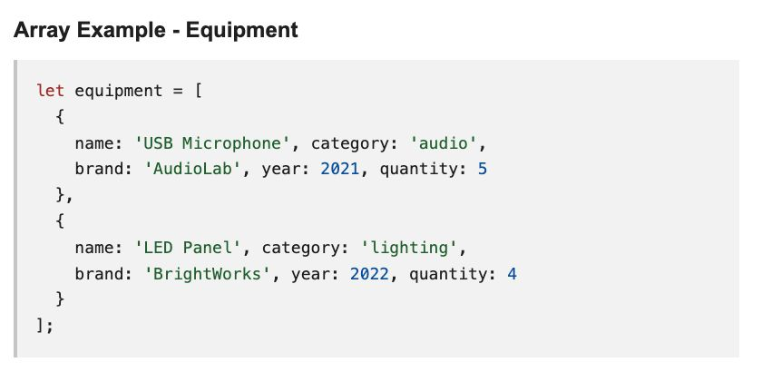
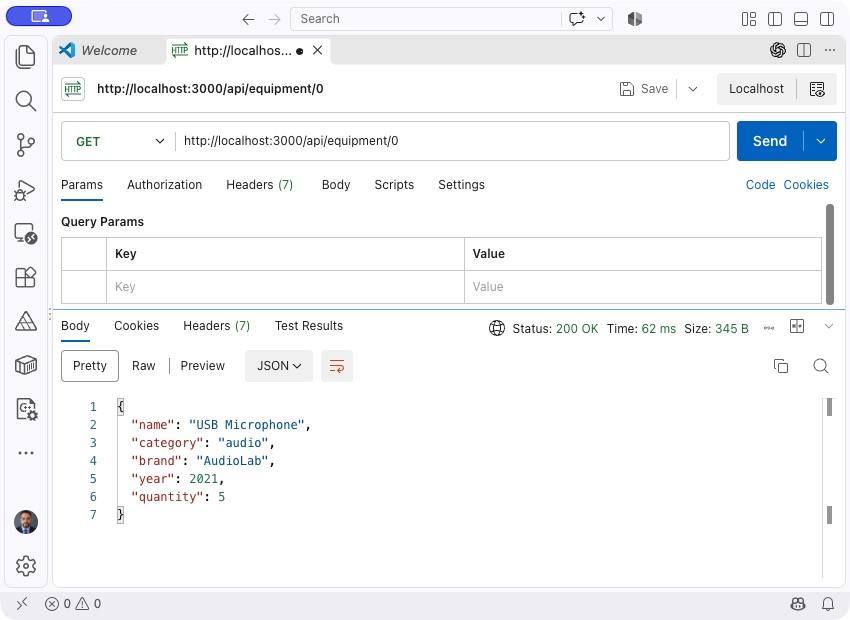

# Midterm API Project - COMP229

## Project Overview
Your task for the COMP229 midterm is to wire up a RESTful API that manages a collection of equipment. An Express server is already configured to run on port `3000`, and a starter collection of equipment data is provided - you just need to implement each endpoint.

**Duration: 120 minutes.**

[Download the instructions PDF](https://cent-col.github.io/COMP229-F26-MIDTERM/instructions.pdf).

### Endpoints
1. **GET /api/equipment** - Retrieve the full list of equipment.
2. **GET /api/equipment/filter?category=[category name]** - Retrieve equipment whose category matches the query.
3. **GET /api/equipment/:id** - Retrieve an equipment item by its array index (ID).
4. **POST /api/equipment** - Add a new equipment item to the collection.
5. **PUT /api/equipment/:id** - Update an equipment item by its array index (ID).
6. **DELETE /api/equipment/:id** - Remove an equipment item by its array index (ID).

The starter data lives in `server.js`, but **you must complete the logic** for every endpoint above. Array indexes start at **0**: `/api/equipment/0` refers to the first item.

### Array Example
Below is an example of the object structure you will manipulate. **An array containing five equipment items is already provided in the code.**



---

## Personalized Requirements

### Tailor the Collection Using Your Student ID
**Add exactly two equipment items to the starter array** based on the last digit of your student ID:
- **0-1:** Add 2 equipment items released between **1990-1999**
- **2-3:** Add 2 equipment items released between **2000-2009**
- **4-5:** Add 2 equipment items released between **2010-2019**
- **6-7:** Add 2 equipment items released between **2020-2026**
- **8-9:** Add 2 **portable** equipment items (any year)

**Example:** Student ID `301234567` ends in 7, so add two equipment items released between 2020-2026.

### Format for Your Additional Equipment
```javascript
{
  name: 'Equipment Name',
  category: 'Category',
  brand: 'Brand Name',
  year: 2024,
  quantity: 2
}
```

### Screenshot Requirement
Capture at least one API response that clearly displays the entire personalized collection (starter equipment + your two additions = 7 total).

---

## Setup Instructions

Use Node.js 22 or later.

### Step 1: Get the starter ZIP

[Download the starter ZIP](https://github.com/CENT-COL/COMP229-F26-MIDTERM/archive/refs/heads/main.zip). If you already downloaded it, use your existing copy.

### Step 2: Extract the ZIP

Extract the ZIP to a folder on your computer. If you already extracted it, continue to step 3.

### Step 3: Open the project in VS Code

In VS Code, select **File > Open Folder**. Open the extracted folder that contains `package.json` and `server.js`.

### Step 4: Install dependencies

In VS Code, select **Terminal > New Terminal**. The terminal must be in the project folder containing `package.json`. Run:

```bash
npm install
```

### Step 5: Start the server

In the same terminal, run:

```bash
npm start
```

The server listens on port `3000`. Stop it with Ctrl+C and restart after editing.

### Step 6: Test the API

Open Postman (desktop or VS Code extension), Thunder Client, Insomnia, or a similar tool. Send requests to `http://localhost:3000` using the six endpoints listed above.

Use the correct method and URL for each request. For POST and PUT, select a raw JSON body and enter the equipment data. Check the response payload and HTTP status code.

You can also run the automated API checks in a terminal:

```bash
npm test
```

The tests start and stop their own server. They check the six endpoints and the seven-item starting collection. Failures are expected until you implement the endpoints and add your two items. Your student-ID personalization and submission screenshots still need to be reviewed.

---

## Submission Requirements

1. **Screenshots**
   Provide clear evidence of testing for **all six endpoints**. Every screenshot must show:
   - Request URL and method
   - Request body when applicable
   - Successful response with status code
   - At least one screenshot highlighting your complete 7-item equipment collection

   **Filename convention:** `[StudentID]_[LastName]_[EndpointNumber]_[Method].png`
   Example: `301234567_Smith_01_GET_ALL.png`

   **Need a reference?** The screenshot below shows the expected Postman layout.

   

2. **Code Submission**
   - Zip your project files, excluding `node_modules` and `.git`.
   - Share the GitHub repository link containing your implementation.
   - Keep screenshots organized and easy to review.
   - Confirm your personalized equipment appears in both code and responses.

3. **Reflection (optional, but recommended)**
   Summarize in a short paragraph how you validated each endpoint and any edge cases considered.

---

## Academic Integrity Notice
**Warning:** Submissions are reviewed for
- Personalized additions that match your student ID rule set
- Proper screenshot naming conventions
- Individual equipment selections across submissions

Suspected irregularities will be investigated according to academic integrity policies.

---

## Good Luck!
Write clean, well-structured code, validate inputs, and handle errors gracefully. You've got this!
